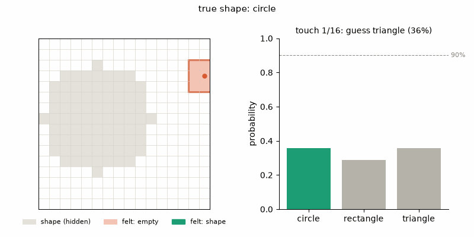
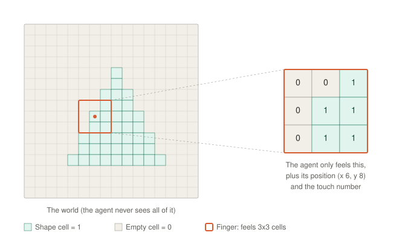

# TouchRL: A Minimal Testbed for Active Tactile Perception

A tactile fingertip learns to find and name a hidden shape without any visual information about the world. It learns where to touch by reinforcement learning and which shape it feels by supervised learning. Written in PyTorch, trained on a laptop CPU.



## How it works



- **World:** a 16x16 board hides one shape: a circle, a rectangle or a triangle. The finger feels only the 3x3 cells under it and has 16 touches.
- **Agent:** a small network with memory (a GRU) that, after every touch, guesses the shape and chooses where to move next.
- **Training:** the guess learns from the right answer (cross-entropy). The moves learn by trial and error with REINFORCE: a move earns more reward the better the guess after it.

## Quick start

Needs [uv](https://docs.astral.sh/uv/). The first `uv run` sets everything up: the packages and, if needed, a matching Python.

```bash
uv run play.py best                  # a trained agent plays a new random world
uv run main.py                       # train your own agent (about a minute)
uv run study.py                      # repeat the whole study (about 4 hours on a laptop)
uv run study.py fingertip sim2real   # only some groups of the study
uv run plot_findings.py              # one figure per finding, from the study results
```

Study groups: `fingertip`, `search`, `reward`, `exploration`, `optimization`, `memory`, `robustness`, `gru_vs_rnn`, `best`, `sim2real`, `zoo` (settings in `sensitivity.toml`).

## Trained agents

`uv run play.py` lists them, `uv run play.py <name>` lets one play. In the game window, **New game** (or the key `n`) starts another world.

| Agent | What is special | Accuracy | Sure after |
|---|---|---|---|
| `best` | Tuned training | 97 % | 5.4 touches |
| `baseline` | The standard setup | 94 % | 6.1 touches |
| `big-finger` | 5x5 fingertip | 98 % | 3.8 touches |
| `point-probe` | 1x1 fingertip | 69 % | 15.1 touches |
| `big-board` | 32x32 board | 89 % | 9.0 touches |
| `memoryless` | No memory | 87 % | 9.0 touches |
| `explorer` | Large exploration bonus | 81 % | 10.3 touches |
| `noisy` | 10 % wrong sensor readings | 86 % | 11.8 touches |
| `sim-trained` | Trained without noise, plays with 10 % | 46 % | 11.9 touches |
| `untrained` | Random weights | 31 % | never |

**Accuracy:** share of 2,048 new worlds in which the shape is named right after all 16 touches. **Sure after:** average touch from which the guess is right and at least 90 % confident until the end; a game where that never happens counts as 17.

## Findings

From one full run of the study: 292 training runs, 3 to 10 seeds per setting.

- **Within a stable training regime, the sensor dominates.** Fingertip size and sensor noise move the accuracy by 24 to 29 percentage points, the learning settings in their stable range by 1 to 4.
- **Without noise, errors come from the search; with noise, from the reading.** Without noise, 86 % of the errors happen because the fingertip never touches the shape.
- **Sim-to-real gap.** Trained on a perfect sensor, the agent's accuracy drops from 94 % to 44 % when 10 % of the readings are wrong. Training with that noise brings it back to 86 %.
- **More exploration, less detection.** A larger entropy bonus makes the moves more random, so the fingertip finds the shape less often (92 % → 70 %).
- **Memory matters most where one touch reveals little.** It adds 5 percentage points with the 3x3 fingertip and 23 with a 1x1 fingertip. Without memory, the 3x3 agent still reaches 90 % by finding an edge and staying on it.

One figure per finding, with statistics, in `results/findings/`. Details and GIFs: [docs/findings.md](docs/findings.md)

## Files

| File | Content |
|---|---|
| `world.py`, `shapes.py` | Board, hidden shapes, fingertip sensor |
| `agent.py` | The network: memory, guess and move |
| `train.py` | Training: cross-entropy for the guess, REINFORCE for the moves |
| `main.py` | Trains one agent and shows its results |
| `play.py`, `agents/` | The named trained agents and the game viewer |
| `study.py`, `sensitivity.toml`, `results/` | The sensitivity study: settings, tables and figures |
| `plot_findings.py`, `results/findings/` | Figures for the study findings, one per finding, each with a caption |
| `visualize.py` | Plots and animations |
| `docs/findings.md` | The findings in detail, with figures and GIFs |
| `pyproject.toml`, `uv.lock` | Dependencies for uv |

## License

MIT, see [LICENSE](LICENSE).
