# Findings

Results of one complete run of the TouchRL sensitivity study (`uv run study.py`, November 2026): 292 training runs in 11 groups, defined in `sensitivity.toml`. Unless stated otherwise, every setting was trained with 3 random seeds for 1,500 rounds and evaluated on 2,048 new episodes after the last of 16 touches. Figures 1 to 13 are produced by `uv run plot_findings.py` and saved in `results/findings/`; their captions give the exact values and tests.

**Terms.** *Accuracy*: share of episodes classified correctly after the last touch. *Detection rate*: share of episodes in which the fingertip contacted the shape at least once. *Accuracy given detection*: accuracy over those episodes. Differences are given in percentage points (pp). p-values come from a two-sided Welch's t-test over seeds and are not corrected for multiple comparisons.

## 1. Within a stable training regime, the sensor dominates

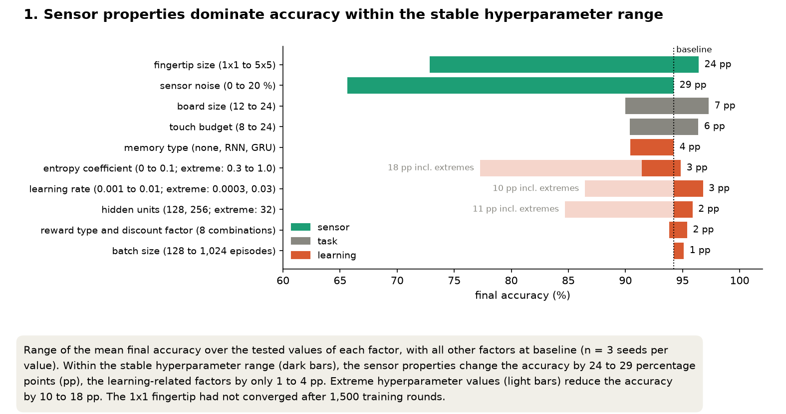

Fingertip size and sensor noise change the accuracy by 24 and 29 pp. Within their stable ranges, the learning-related factors (memory type, hidden units, learning rate, batch size, reward, discount factor, entropy coefficient) change it by only 1 to 4 pp. A larger or more reliable tactile sensor is therefore worth more than further tuning of the learner, with three qualifications:

- **The learner must be configured sensibly.** Extreme values (32 hidden units, a learning rate of 0.0003, an entropy coefficient of 0.3 or more) cost 10 to 18 pp.
- **Coverage is free in simulation.** On a robot, more taxels (sensing points) cost wiring, weight and readout bandwidth.
- **Policy and memory matter where sensing is sparse.** The less a single touch reveals, the more they contribute (section 7).

## 2. Without noise, errors are detection failures; with noise, misclassifications

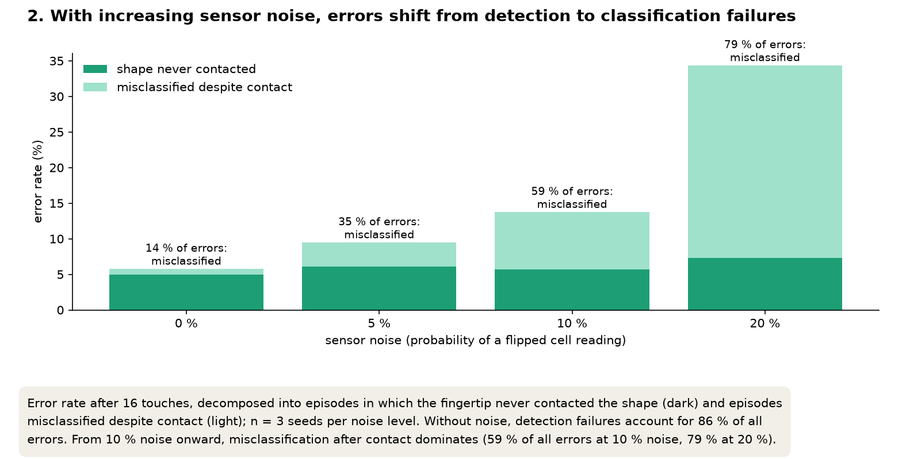

Without sensor noise, 86 % of all errors occur in episodes in which the fingertip never contacted the shape; once in contact, the agent classifies 99 % of the shapes correctly. From 10 % noise onward, most errors are misclassifications after contact (59 % of the errors at 10 % noise, 79 % at 20 %). Accuracy alone does not show this distinction; the detection rate and the accuracy given detection do. Macro-F1 does not separate the two failure modes either: in these settings it stays within 1 pp of the accuracy.

## 3. Undetected shapes are classified as triangles

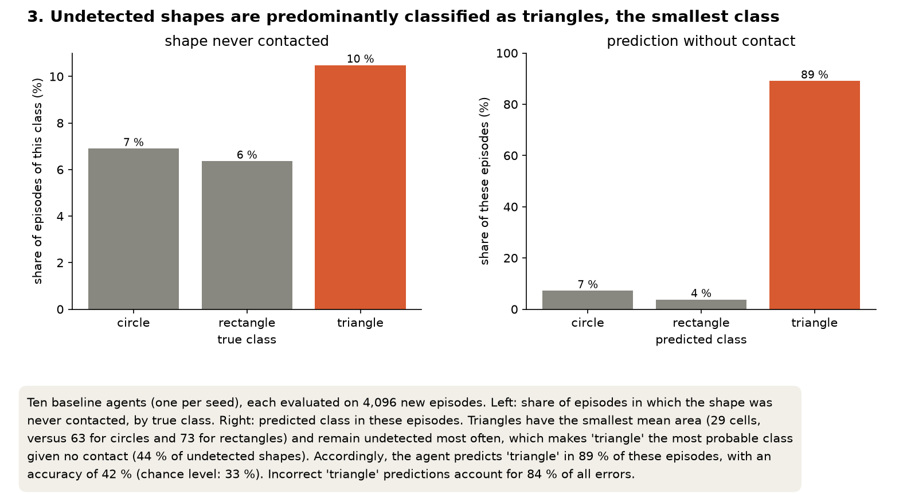

Triangles are the smallest class: the shape generator draws a base of 3 to 15 cells and a height of half the base, which gives a mean area of 29 cells in the evaluated episodes, compared with 63 for circles and 73 for rectangles. The fingertip therefore misses triangles most often, and the absence of any contact makes triangle the most probable class (about 44 % of the undetected shapes are triangles). The agents have learned this prior: without contact, they predict "triangle" in about 89 % of the episodes and are correct in about 42 %, compared with 33 % for a blind guess. These predictions account for about 84 % of all errors.

*Memoryless agent: never contacts the small triangle and predicts "triangle", correct by chance.*

**Next step.** Most errors therefore originate in the search, not in the classification. This motivates letting the agent choose its own step size: large moves to cover the board quickly, small moves to read an edge. Section 4 shows that larger fixed steps already raise the detection rate.

## 4. Larger steps increase the detection rate

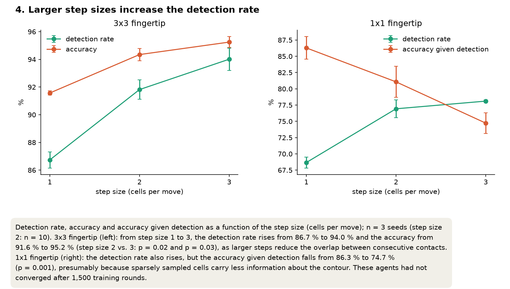

With the 3x3 fingertip, increasing the step size from 1 to 3 cells raises the detection rate from 86.7 % to 94.0 % and the accuracy from 91.6 % to 95.2 %, because consecutive contacts overlap less. With the 1x1 fingertip, the detection rate rises as well, but the accuracy given detection falls from 86.3 % to 74.7 %, presumably because sparsely sampled cells carry less information about the contour. The 1x1 agents had not converged after 1,500 rounds.

## 5. A larger entropy bonus lowers detection, mainly through random actions at test time

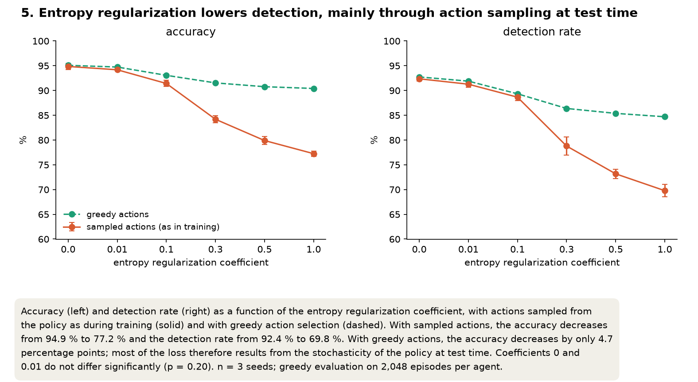

The entropy bonus rewards random moves during training, and the trained policy remains random when it plays. As the coefficient rises from 0 to 1.0, the detection rate falls from 92.4 % to 69.8 % and the accuracy from 94.9 % to 77.2 %. With greedy actions (always the most likely move), the accuracy loss shrinks to about 5 pp, so most of the loss comes from action sampling at test time. A coefficient of 0 performs as well as the default of 0.01 (p = 0.20): the agent explores enough without a bonus, presumably because every training round starts from 512 new boards and random start positions.

Watch it with `uv run play.py explorer`, and with `--greedy` for its most likely moves.

## 6. Sim-to-real gap: noise-free training fails under sensor noise

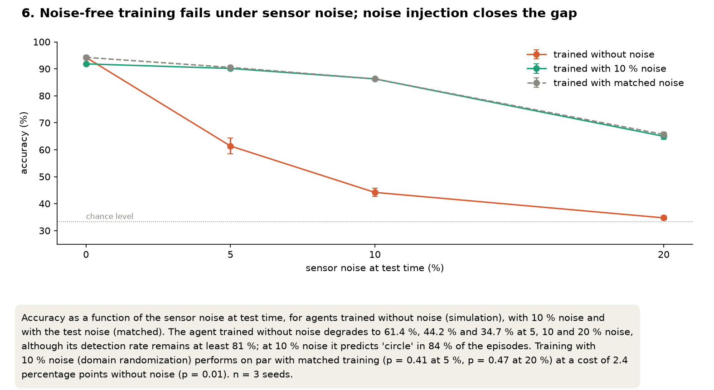

| Sensor noise at test time | Trained without noise | Trained with 10 % noise | Trained with the test noise |
|---|---|---|---|
| 0 % | 94.2 % | 91.8 % | 94.2 % |
| 5 % | 61.4 % | 90.1 % | 90.5 % |
| 10 % | 44.2 % | 86.3 % | 86.3 % (same runs) |
| 20 % | 34.7 % | 65.0 % | 65.6 % |

An agent trained on a perfect sensor (the "simulation") degrades sharply on a noisy one (the "real world"): 5 % wrong readings already cost 33 pp. It still contacts the shape in at least 81 % of the episodes, but misreads it: at 10 % noise, 84 % of its predictions are "circle", presumably because scattered wrong cells resemble a curved edge (watch it with `uv run play.py sim-trained`). Training with 10 % noise performs on par with noise-matched training at every tested noise level above zero (p ≥ 0.41) and costs 2.4 pp on a perfect sensor (p = 0.01). Adding noise during training is a simple form of domain randomization: the policy is trained on many variations of the simulation, so that reality appears as one more variation. It is a standard way to transfer policies from simulation to real robots.

## 7. Memory matters most where a single touch reveals little

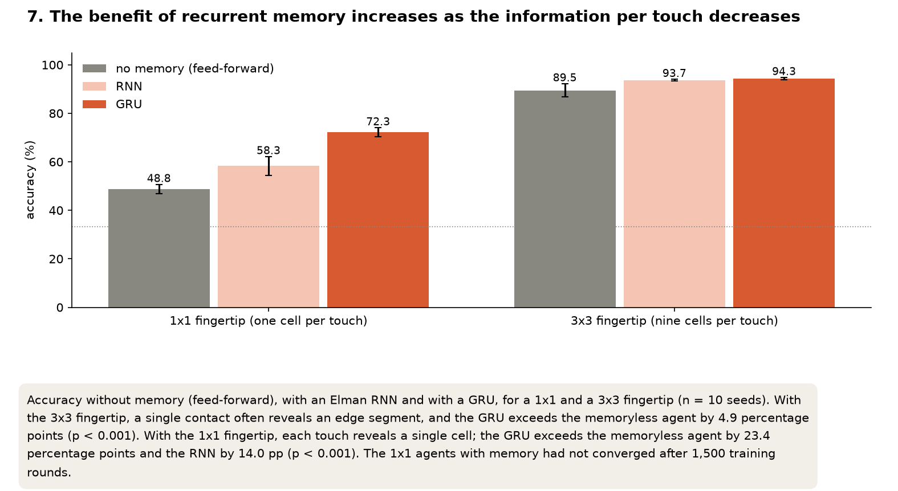

With the 3x3 fingertip, a GRU memory adds 4.9 pp over a memoryless agent (10 seeds, p < 0.001). With the 1x1 fingertip, each touch reveals a single cell, and the shape has to be assembled over many touches: memory adds 23.4 pp, and the gated GRU exceeds the plain RNN by 14.0 pp (p < 0.001). The 1x1 agents with memory had not converged after 1,500 rounds.

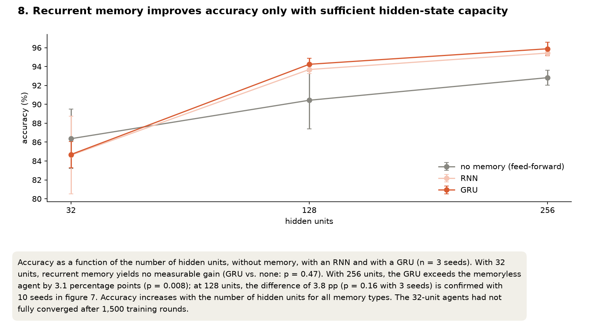

Memory also needs capacity. With 32 hidden units, it yields no measurable gain (p = 0.47); with 256 units, the GRU exceeds the memoryless agent by 3.1 pp (p = 0.008). A larger network improves all agents.

### Why the memoryless agent still reaches 90 %

Without any memory, the agent still classifies 89.5 % of the shapes correctly after 16 touches (GRU: 94.3 %, 10 seeds each). A first hypothesis was that the fingertip position acts as a memory. It does not.

The test: at the last touch, hide one input and observe the effect (one agent of each kind, trained with the baseline settings).

| Hidden at the last touch | Accuracy of the memoryless agent |
|---|---|
| nothing | 91 % |
| the patch (what it feels) | 34 % (chance) |
| the position (shuffled) | 89 % |

The agent therefore classifies from what it currently feels. What it has learned is to **find an edge and stay on it**:

- 86 % of its episodes end on an edge (GRU 51 %, random moves 23 %).
- In the second half of an episode, 63 % of its moves are "stay" (GRU 8 %).
- A single 3x3 piece of edge, straight, curved or slanted, identifies the shape in 95 % of the cases.
- With random moves, it never improves on its first touch: staying on an edge is its entire strategy.

| Accuracy after touch | 1 | 4 | 8 | 16 |
|---|---|---|---|---|
| Memoryless | 48 % | 67 % | 85 % | 91 % |
| GRU memory | 48 % | 76 % | 89 % | 95 % |
| Memoryless, random moves | 48 % | 48 % | 46 % | 43 % |

The GRU agent keeps exploring after it is confident, feels 69 different cells instead of 45, and is correct earlier.

| Memoryless: stays on the edge | GRU: same board, keeps exploring |
|---|---|
| 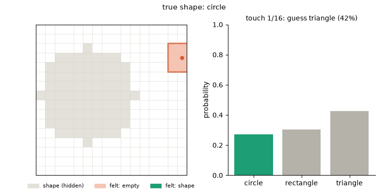 |  |

*Memoryless agent: wanders until it first contacts the rectangle at touch 5. Without memory, its confidence then changes with every touch (98 %, 57 %, 74 %, 95 %, 82 % ...), because it only judges the patch it currently feels.*

## 8. Training hyperparameters

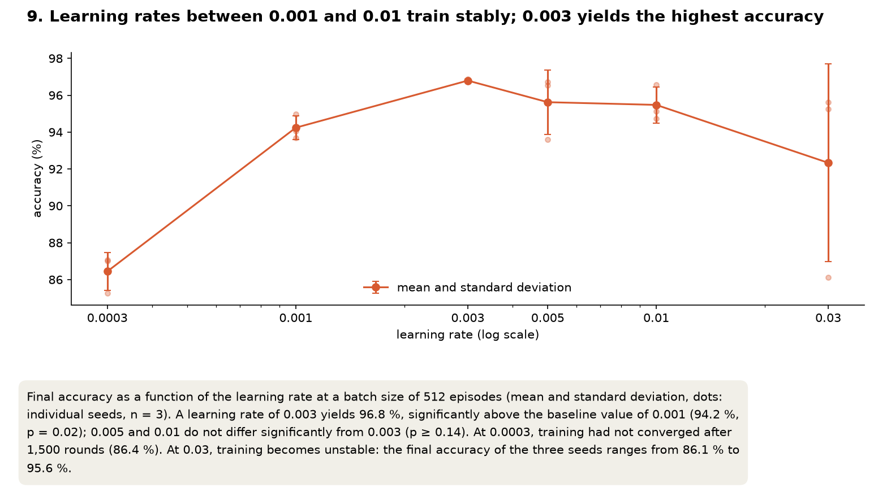

Learning rates from 0.001 to 0.01 train stably. A learning rate of 0.003 gives the highest accuracy (96.8 % versus 94.2 % at the baseline value of 0.001, p = 0.02); 0.005 and 0.01 do not differ significantly from it. At 0.0003, training had not converged after 1,500 rounds; at 0.03, it becomes unstable, with final accuracies from 86.1 % to 95.6 % across seeds.

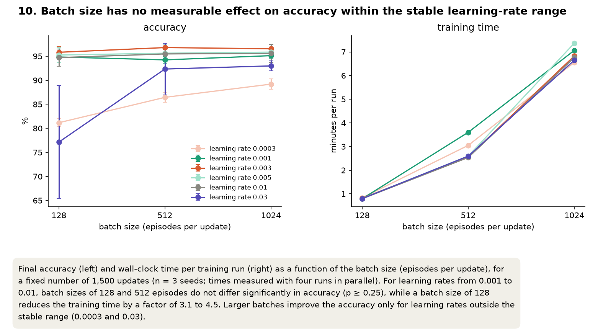

Within the stable learning-rate range, batches of 128 episodes per update do not differ significantly in accuracy from 512 or 1,024 (p ≥ 0.25) and train 3.1 to 4.5 times faster. Larger batches only help when the learning rate is too small or too large.

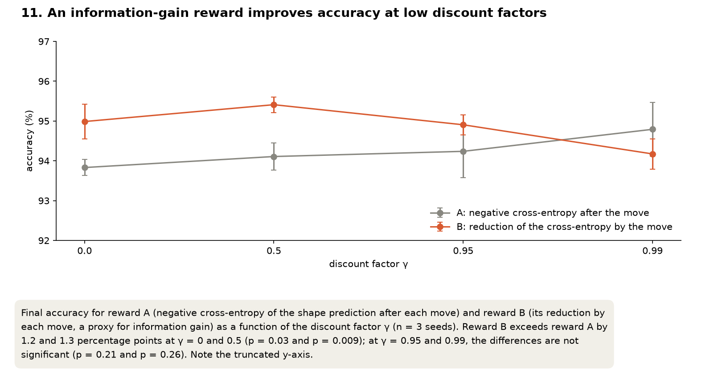

Reward B (the reduction of the cross-entropy of the shape prediction by a move) exceeds reward A (the negative cross-entropy after the move) by 1.2 and 1.3 pp at γ = 0 and 0.5 (p = 0.03 and 0.009). At γ = 0.95 and 0.99, the differences are not significant.

**Next step.** Reward B is only a proxy for information gain: it measures how much a move raises the predicted log-probability of the true shape, and therefore requires the label. A formulation of actual information gain, for example the reduction of the entropy of the agent's belief over the shapes, would need no label and is an interesting next step.

## 9. Under sensor noise, tuning improves classification rather than detection

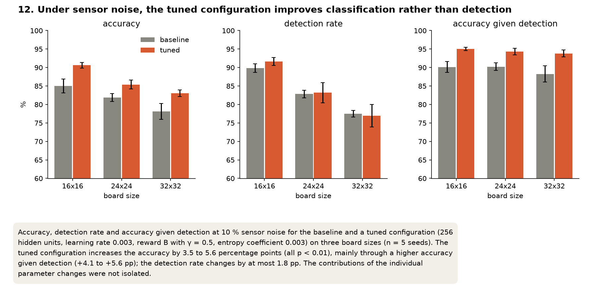

At 10 % sensor noise, a tuned configuration (256 hidden units, learning rate 0.003, reward B with γ = 0.5, entropy coefficient 0.003) is 3.5 to 5.6 pp more accurate than the baseline on 16x16, 24x24 and 32x32 boards (5 seeds, all p < 0.01). The gain comes mainly from a higher accuracy given detection (+4.1 to +5.6 pp); the detection rate changes by at most 1.8 pp. The contributions of the individual changes were not isolated.

## 10. Additional touches compensate for low, not for high sensor noise

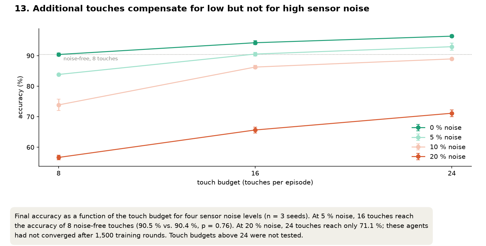

At 5 % noise, 16 touches reach the accuracy of 8 noise-free touches (90.5 % versus 90.4 %). At 20 % noise, even 24 touches reach only 71.1 %; these agents had not converged after 1,500 rounds, and larger budgets were not tested.

## 11. Coverage: one quantity for fingertip, board and touch budget

Coverage budget = touches × fingertip area / board area: the largest share of the board the fingertip can feel if it never contacts a cell twice. The baseline has 16 × 9 / 256 = 0.56.

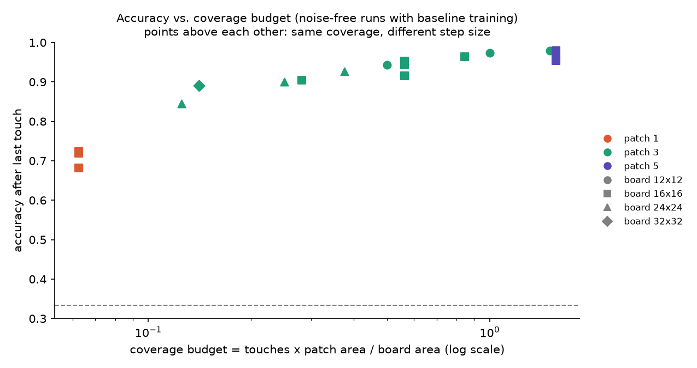

| Coverage budget | 0.06 | 0.125 | 0.25 | 0.56 | 1.0 | 1.5 |
|---|---|---|---|---|---|---|
| Setting | 1x1 fingertip | 24x24 board, 8 touches | 24x24 board, 16 touches | baseline | 12x12 board, 16 touches | 12x12 board, 24 touches |
| Accuracy | 72.9 % | 84.5 % | 90.0 % | 94.2 % | 97.3 % | 97.9 % |

All noise-free fingertip and board settings fall roughly onto one rising curve, with diminishing returns for each doubling of the coverage budget. Overlapping touches (step size 1) fall below the curve, because they feel the same cells twice.

## Limitations

- Most settings were trained with 3 seeds (memory and fingertip comparison: 10, tuned configuration: 5). The p-values are not corrected for multiple comparisons; differences below 1 pp should be treated as uncertain.
- Every run was trained for a fixed 1,500 rounds. Some settings had not converged (1x1 fingertip, learning rate 0.0003, 32 hidden units, 20 % noise with 24 touches); longer training would likely raise their accuracy.
- During evaluation, actions are sampled from the policy as in training; only figure 5 also evaluates greedy actions.
- The shape generator gives the classes different size distributions (triangles are the smallest), so class and size are confounded (section 3).
- The named agents in `agents/` come from an earlier training run with the same settings. `results/zoo.csv` contains their retrained versions from this study, whose accuracies differ by up to 3.2 pp.

## Next steps

- **Let the agent choose its own step size** (sections 3 and 4): large moves to search, small moves to read, to reduce the undetected shapes that cause most errors.
- **Reward actual information gain** (section 8): a label-free reward based on the reduction of the agent's uncertainty about the shape.
