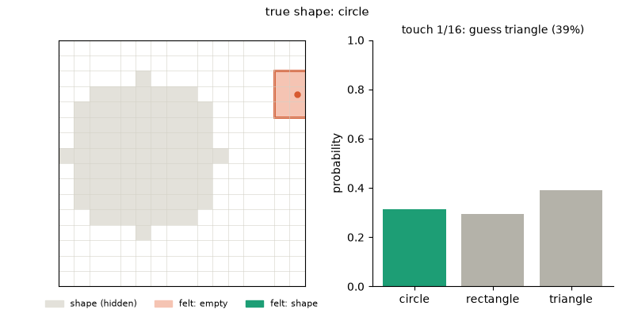
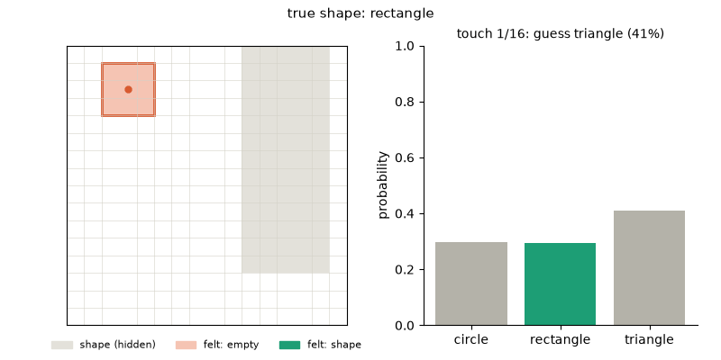
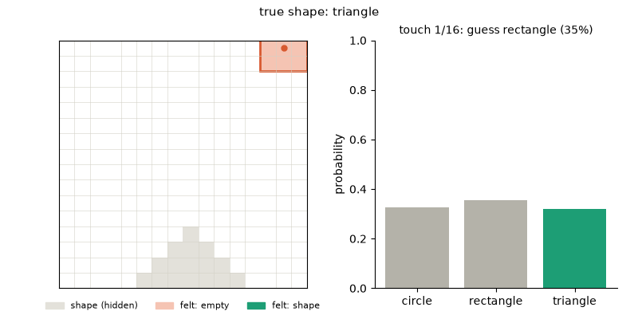

# Findings

Notes from the TouchRL study, November 2026. Sections marked as preview use one trained agent each; the study repeats them with three seeds. The tables and figures in `results/` come from the first full run of the study (seven groups, three seeds each) and from the named agents; the groups added later are defined in `sensitivity.toml` but not run yet.

## Key learning: the sensor matters more than the learner

In this task, what the sensor delivers per touch matters more than tuning the learner. Coverage per touch relative to the world (72 → 98 % from patch 1 to patch 5) and sensor noise (94 → 66 % from 0 to 20 % noise) move accuracy by 25 to 30 points. Reward, γ and the exploration bonus (up to 0.1) move it by 1 to 2 points, and the learning rate by about 3 once training works at all. Most remaining errors come from never finding the shape, not from misreading it. A bigger or denser tactile sensor can be worth more than polishing the policy.

Caveats:

- **The RL settings still have to work.** With a learning rate of 0.0003, the agent had not finished learning after 1,500 rounds.
- **Coverage is free in a simulation.** On a robot, more taxels (sensing points) cost wiring, weight and readout bandwidth.
- **The flip side.** The more one touch reveals, the less the policy matters. A smart policy and memory pay off exactly where sensors are sparse.

## Coverage: one number for fingertip, board and touch budget

Coverage budget = touches × patch area / board area: the share of the board the finger can feel at most if it never touches a cell twice. The baseline has 16 × 9 / 256 = 0.56.

| Coverage budget | 0.06 | 0.125 | 0.25 | 0.56 | 1.0 | 1.5 |
|---|---|---|---|---|---|---|
| Accuracy | 72 % | 85 % | 90 % | 94 % | 97 % | 98 % |

All noise-free fingertip and board settings fall roughly onto one rising curve, and each doubling of coverage helps less. Two kinds of runs fall below it: overlapping touches (step size 1), which feel the same cells twice, and the point probe (patch 1), which cannot see which way an edge runs and had not finished learning.

## Sim2real gap (preview)

An agent trained with a perfect sensor (the "simulation") falls apart when its sensor is noisy (the "real world"). Training with noise closes the gap almost completely. Preview with one agent each, tested on 4,096 new worlds; the study group `sim2real` repeats this with 3 seeds.

| Noise in the test world | Trained without noise | Trained with 10 % noise | Trained with the test noise (3 seeds) |
|---|---|---|---|
| 0 % | 95 % | 92 % | 94 % |
| 5 % | 67 % | 90 % | 90 % |
| 10 % | 45 % | 86 % | 86 % |
| 20 % | 34 % (chance) | 65 % | 66 % |

Already 5 % wrong readings cost the noise-free agent 28 points. It takes the noise for a shape: at 10 % noise it answers "circle" for 85 % of the rectangles and 68 % of the triangles, probably because scattered wrong cells look like a curved edge (watch it with `uv run play.py sim-trained`). The agent trained with 10 % noise is as good as an agent trained for each noise level, even at 20 %, and loses only about 3 points on a perfect sensor. Adding noise in training on purpose is a simple form of domain randomization: training on many variations of the simulation, so that reality looks like just one more variation. It is a standard way to make policies from simulation work on real robots.

## Exploration: more dice, less search (preview)

A bigger exploration bonus makes the agent find the shape less often, not more often, and misread it more often. One agent per bonus, tested on the same 4,096 new worlds. "Moves it picks from" says how many of the 9 moves it effectively uses: 1 = always the same move, 9 = all equally likely.

| Exploration bonus | Moves it picks from | Shape found | Right when found | Right overall | Right with its most likely moves |
|---|---|---|---|---|---|
| 0 | 1.6 | 93 % | 99 % | 95 % | 95 % |
| 0.01 (baseline) | 3.9 | 92 % | 99 % | 95 % | 95 % |
| 0.1 | 7.5 | 90 % | 98 % | 92 % | 95 % |
| 0.3 | 8.6 | 80 % | 96 % | 85 % | 93 % |
| 0.5 | 8.9 | 74 % | 95 % | 81 % | 91 % |
| 1.0 | 9.0 (pure chance) | 69 % | 94 % | 77 % | 91 % |

- **The bonus makes the search more random, not smarter.** A random path crosses itself and feels fewer different cells (68 → 55 of 256), so it misses more shapes. Most mistakes come from never touching the shape; once the finger has touched it, the guess is right 94 to 99 % of the time.
- **Exploration is a training tool.** The dice help the agent discover good moves while it learns, but the bonus also keeps it rolling dice while it plays. Taking its most likely move instead brings the agent with bonus 1.0 back from 77 % to 91 %. Still, none of them beats the agents with little or no bonus: this agent explores enough without one, probably because it starts out random and every training round brings 512 new boards and start points.
- **Accuracy alone hides this.** The useful split is "shape found" (search) and "right when found" (reading). Macro-F1 does not separate the two: with equally likely shapes it moves together with accuracy.

Watch it with `uv run play.py explorer`, and with `--greedy` for its most likely moves.

## Why the memoryless agent still reaches 90 %

Without any memory, the agent still names 90 % of the shapes after 16 touches (with GRU memory: 94 %). A first guess was that the finger's position works as a memory. That guess is wrong.

The test: at the last touch, hide one input and see what breaks (one agent of each kind, trained with the baseline settings).

| Hidden at the last touch | Accuracy of the memoryless agent |
|---|---|
| nothing | 91 % |
| the patch (what it feels) | 34 % (chance) |
| the position (shuffled) | 89 % |

So the agent reads the answer from what it feels right now. What it really learned is **find an edge and park on it**:

- 86 % of its games end on an edge (GRU 51 %, random moves 23 %).
- In the second half of a game, 63 % of its moves are "stay" (GRU 8 %).
- One 3x3 piece of edge, straight, curved or slanted, names the shape 95 % of the time.
- With random moves it never gets better than after its first touch: parking is its whole strategy.

| Accuracy after touch | 1 | 4 | 8 | 16 |
|---|---|---|---|---|
| Memoryless | 48 % | 67 % | 85 % | 91 % |
| GRU memory | 48 % | 76 % | 89 % | 95 % |
| Memoryless, random moves | 48 % | 48 % | 46 % | 43 % |

The GRU agent keeps exploring after it is sure, feels 69 different cells instead of 45, and is right earlier.

| Memoryless: parks on the edge | GRU: same board, keeps exploring |
|---|---|
|  |  |

*Memoryless agent: wanders until it first touches the rectangle at touch 5. Without memory, its confidence then jumps with every touch (98 %, 57 %, 74 %, 95 %, 82 % ...), because it only judges the patch it feels right now.*

### The remaining errors: betting on triangle

About 80 % of all mistakes are wrong "triangle" guesses, and nearly all of them come from games where the finger never touched the shape. That happens in 8 % of the games for the GRU agent and in 13 % for the memoryless one. When nothing has been felt, triangle is the best bet: triangles cover 11 % of the board on average, circles and rectangles 25 to 28 %, so "found nothing" points to a triangle. The bet is right 42 to 45 % of the time, better than the 33 % of a blind guess.

*Memoryless agent: never touches the small triangle and bets on "triangle", right by luck.*

### What this means for the task

With a 3x3 fingertip, one good touch is almost enough, so memory and planning cannot show what they are worth. To make them matter, the fingertip has to be small compared with the features of the shape, as with the point probe (patch 1). The study group `gru_vs_rnn` tests exactly that.
